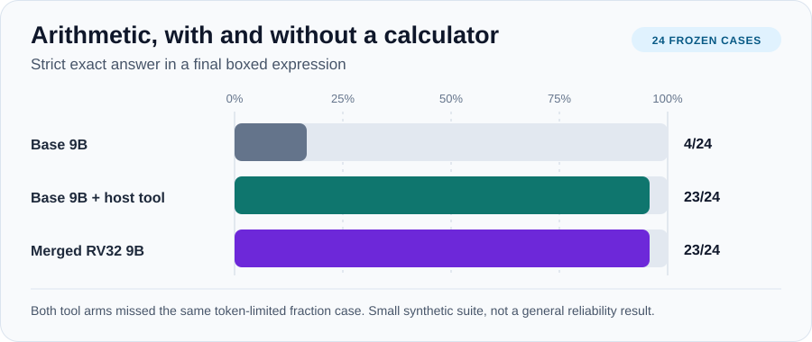
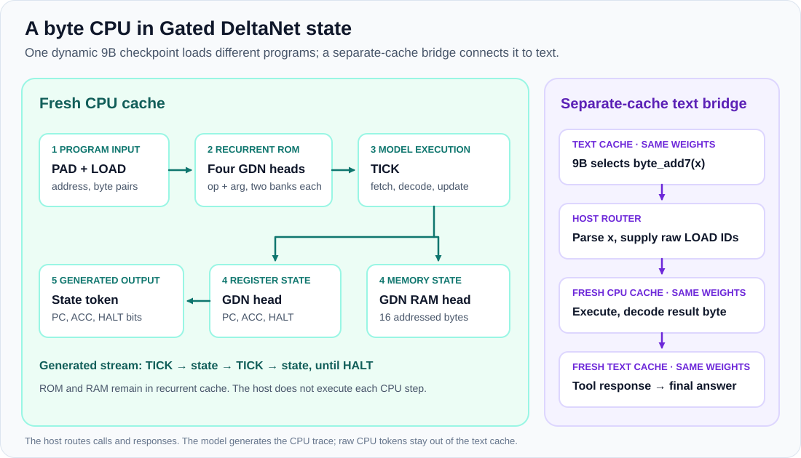

<p align="center">
  
</p>

# QwenCPU

[](https://github.com/arpjw/qwencpu/actions/workflows/ci.yml)
[](LICENSE)

**QwenCPU compiles an 8-bit CPU into stock Qwen3.5 layers, then inserts those layers before pretrained Qwen3.5-9B.** Its ROM, RAM, and registers live in Gated DeltaNet state. A `LOAD` token writes a byte of program memory; a generated `TICK` executes one instruction. No CPU weights are trained.

One merged 9B checkpoint ran different bytecode programs from input tokens. Its copied text weights also selected a `byte_add7` tool in 7 of 8 frozen prompts, and the same checkpoint generated the CPU result in a fresh cache. The host parsed the call and returned that result as normal tool text. [The complete results](RESULTS.md) include exact traces, cache checks, and the limits of this prototype.

This repository also includes a **separate** port of [Qwenputer's](https://github.com/divagr18/qwenputer) RV32 calculator merge to Qwen3.5-9B. That port preserves 9B's untied output head and supports a three-arm arithmetic comparison.

<p align="center">
  
</p>

## What works

| Experiment | Observed result |
| --- | --- |
| Dynamic 8-bit CPU in pretrained 9B | 12/12 frozen short programs and 2/2 high-address programs exact, including every generated token and recurrent ROM/RAM snapshot |
| Optimized Gated DeltaNet path | Both suites remained exact on CUDA with Flash Linear Attention's Gated DeltaNet kernels |
| Same-checkpoint text-to-CPU bridge | 7/8 valid tool calls, seven exact generated CPU traces, 8/8 exact boxed answers |
| Separate RV32 calculator port | 23/24 strict answers, matching base 9B with a host calculator; all 24 merged streams replayed exactly |

The arithmetic set has 24 synthetic cases, and the tool-selection set has eight. These are bounded checks of execution and integration, not broad reliability claims. [Raw results and protocol](RESULTS.md) · [RV32 comparison](BENCHMARK.md)

## Quickstart

The reference CPU and its circuit checks need only Python:

```sh
git clone https://github.com/arpjw/qwencpu.git
cd qwencpu
python3 -m gdn_cpu
python3 -m unittest discover -s tests -v
```

The demo prints `verified 12 steps; accumulator=1; RAM[5]=1`. Tests requiring the Qwenputer backend skip when its optional model dependencies are absent. CI runs the dependency-free checks and verifies the frozen fixture hashes.

To build a real 9B checkpoint, follow [REPRODUCE.md](REPRODUCE.md). The measured build used a 96 GB GPU and temporary storage for the 19 GB base model plus a roughly 34 GB dynamic-CPU checkpoint. Model weights are not included here.

## A program in the model's state

<p align="center">
  
</p>

The byte CPU has a 256-byte ROM, 16 bytes of RAM, and a program counter, accumulator, and halt bit. It supports `NOP`, load/add immediate, RAM load/store, conditional jump, and halt. The full dynamic circuit uses four Gated DeltaNet heads for two copies of ROM, one for registers, and one for RAM. The same checkpoint can run multiple programs when each starts with a fresh cache.

The ISA, reference emulator, and transition circuit are independent work in this repository. The compiler reuses Qwenputer's MIT-licensed generic Qwen3.5 IR, gates, scheduler, and weight emitter. [Design and token protocol](DYNAMIC_ROM.md) · [9B merge details](BYTE9B.md) · [Third-party notices](THIRD_PARTY_NOTICES.md)

## Text handoff and tool routing

Ordinary text stayed close to the base model in a fixed 12-prompt check: all 12 kept the same next token and first eight greedy tokens. An in-band CPU trace inserted into two chat prompts changed both next-token choices. Compressing the CPU tokens' position IDs did not restore them. That measured handoff effect remains open.

The working bridge uses **separate caches of one merged 9B model**. The model writes a `byte_add7` call, the host routes raw program tokens to a fresh CPU cache, and the model generates the byte result. The host formats the result as a tool response in a fresh text cache. The CPU arithmetic comes from model generation; parsing, cache routing, and response formatting remain host work. [Bridge code](gdn_cpu/byte9b_bridge.py) · [Eight-case evidence](results/byte9b_bridge_9b.summary.json)

## The separate RV32 port

Qwenputer's published RV32 merge targets Qwen3.5-4B, whose output embedding is tied. Qwen3.5-9B has a learned, untied `lm_head.weight`. [Our patch](qwenputer-9b-port.patch) carries that head through the widened checkpoint and adds CPU-token output rows. On 24 frozen arithmetic cases, base 9B scored 4/24, base 9B with a host calculator scored 23/24, and the merged RV32 model scored 23/24. Every merged stream replayed against the reference machine with zero mismatches. The merged arm generated 160,008 CPU tokens and did not outperform the host calculator on this set. [Method and caveats](BENCHMARK.md) · [Port validation](VALIDATION.md)

## Rebuild and provenance

- [REPRODUCE.md](REPRODUCE.md) pins the upstream checkout, Qwen3.5-9B snapshot, environment, and commands.
- [eval/frozen](eval/frozen) contains the immutable arithmetic, bytecode, and tool-selection fixtures.
- [eval/results](eval/results) and [results](results) contain per-case outputs, cache checks, replay diagnostics, and package versions.
- [tests](tests) covers the emulator, gates, and compiler IR. The final reference-kernel suite passed 18/18 tests. CUDA model runs are recorded as artifacts, not run in GitHub Actions.

QwenCPU is not affiliated with Qwenputer or the Qwen model team. Qwenputer's original RV32 system and generic compiler are by Divyansh Agrawal; this repository preserves its MIT notice in [THIRD_PARTY_NOTICES.md](THIRD_PARTY_NOTICES.md). The original code here is [MIT licensed](LICENSE). Qwen3.5 weights must be obtained separately under their own terms. For research use, cite both [QwenCPU](CITATION.cff) and [Qwenputer](https://github.com/divagr18/qwenputer#citing).
